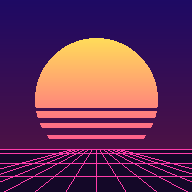
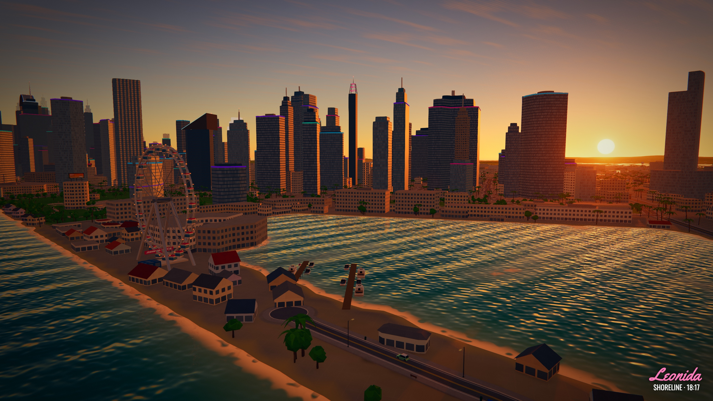
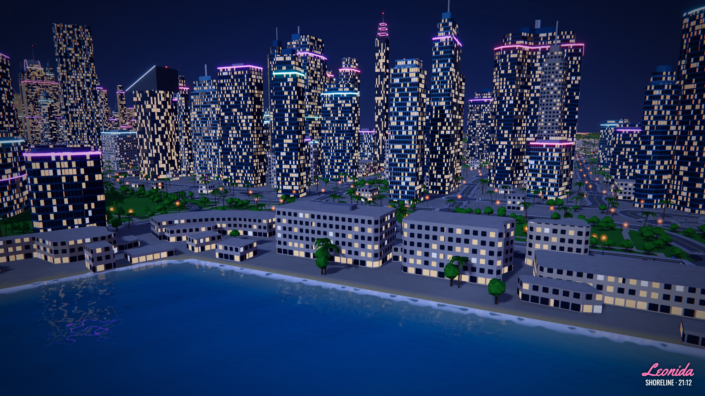
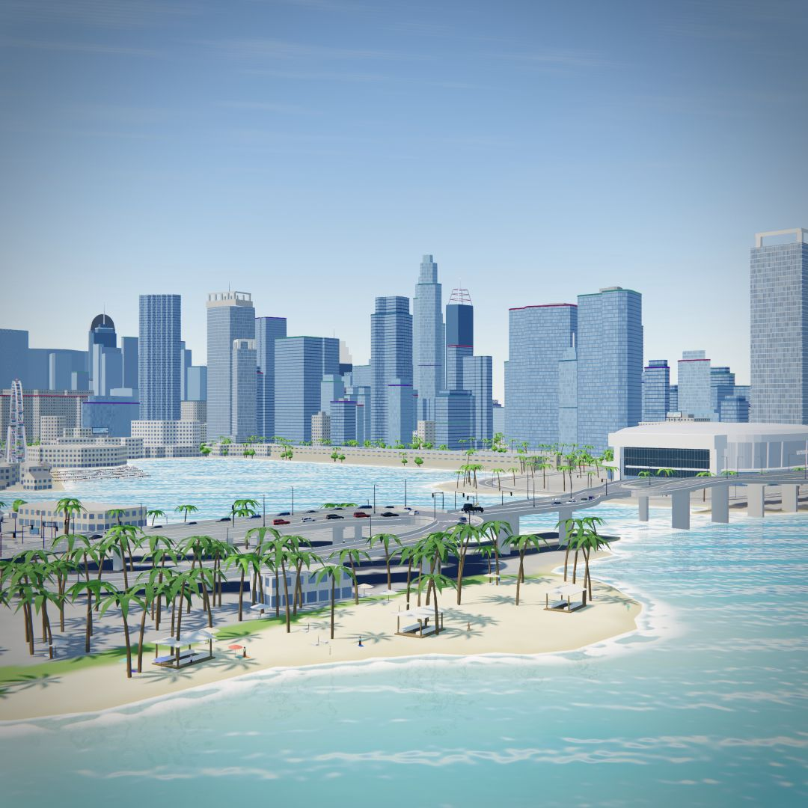
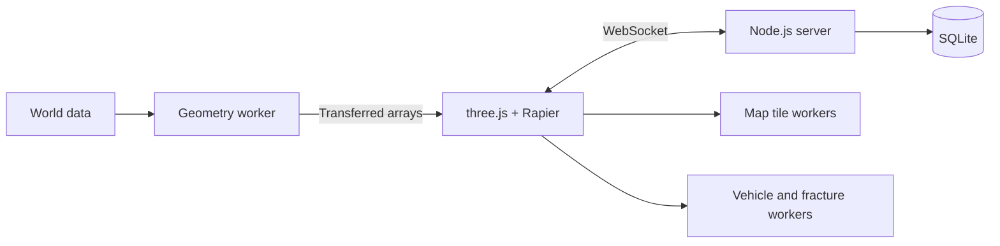

<p align="center"><a href="https://leonida-drive.io"></a></p>
<h1 align="center">Leonida Drive</h1>
<p align="center"><strong>An open-world road trip. Straight from your browser.</strong></p>
<p align="center"><a href="https://leonida-drive.io"><strong>▶ OPEN THE PROJECT — leonida-drive.io</strong></a><br>
<a href="README.ru.md">Русский</a> · <a href="#run-locally">Run locally</a> · <a href="docs/ARCHITECTURE.md">Architecture</a> · <a href="LEGAL.md">Legal & credits</a></p>
<p align="center">
<a href="https://github.com/IPRIT/leonida-drive/actions/workflows/check.yml"></a>


</p>



Explore a low-poly interpretation of Leonida: coastal streets, highways, islands, airfields and mountain roads. Drive, ride, fly or sail; meet other players, find postcards, run time trials, and make a spectacular mess of the scenery.

> [!IMPORTANT]
> **Unofficial, free, non-commercial fan project.** Not affiliated with or endorsed by Rockstar Games or Take-Two Interactive. No original Rockstar game files, artwork, music, logos or footage are used. Models, textures, sounds and music are made from scratch or generated in code. **18+**: cartoon violence, crashes and explosions. [Full legal notice](LEGAL.md).

## A world to spend time in

| Explore | Make it yours |
| --- | --- |
| 139 vehicles: cars, motorcycles, bicycles, aircraft, boats and a tank | Garage, paint finishes, window tint, neon and wardrobe |
| Roads, intersections, bridges, tunnels and 36 parks | GPS routes, an interactive map and a rotating minimap |
| Traffic, pedestrians, street furniture and original landmarks | Time trials, deliveries, collectibles and a shared online economy |
| Day and night, weather, procedural audio and breakable scenery | Keyboard, controller and touch input; 30 interface languages |

Choose multiplayer on the start screen. Opening its menu keeps the shared world running. Other players appear as coloured arrows with names on both maps; dense groups combine into bounded markers, and the player layer has its own persistent filter.

For a sharper view, disable **Dynamic resolution** and set **Resolution scale** between 50% and 200%. Manual 100% uses the display's native resolution. Choose FXAA, SMAA, or hardware-supported MSAA + SMAA separately; the renderer limits oversized buffers to the GPU's capabilities. An overturned car shows an **R** recovery prompt.

Highway elevations are fitted across the whole network, with separate routing levels at 28 crossings. Tests check pavement continuity, bridge clearance and lane coverage. Heights and landmark silhouettes remain a fan reconstruction; they are not official GTA VI map measurements. Online rankings use cash balance only. All vehicles are available immediately in multiplayer except the tank, which costs $50,000. Free vehicles cannot be sold.

## Run locally

Use **Node.js 22.13+** and npm. Ready-to-use world data is included in `public/data`; Python is only needed to regenerate it.

```bash
git clone https://github.com/IPRIT/leonida-drive.git
cd leonida-drive
npm ci
npm run dev
```

Open **[127.0.0.1:5317](http://127.0.0.1:5317/)** in a WebGL2-capable browser. Choose **Singleplayer** to explore without a server. For local multiplayer, use a second terminal:

```bash
cd server
npm ci
npm start
```

The local WebSocket server uses port 8787. Use `localhost` and `127.0.0.1` for two test players: they keep separate browser identities. Two clients on the same origin share a profile; the newer connection takes over.

```bash
npm run build     # static production client in dist/
npm run preview   # preview the build on port 5318
```

For your own hosted server, set `VITE_MP_URL=wss://your-host/ws` when building. Configuration, persistence and deployment: [server/README.md](server/README.md). Client and server protocol versions must match.

## Controls

| Input | Action |
| --- | --- |
| `W A S D` / arrows | Drive or move |
| `Space` / `Shift` | Handbrake / boost |
| `F` | Enter / leave a vehicle |
| `R` | Put your vehicle back on its wheels |
| `G` / `E` | Horn / interact |
| `C` | Change camera |
| `H` / `L` | Lights / emergency lights, where available |
| `M` / click the minimap | Map and GPS |
| `Tab` | Player list |
| `Esc` | Menu, vehicles, wardrobe and settings |
| `V` / `P` | Free camera / photo mode |

The **Controls** tab lists vehicle-specific, controller and mobile controls. Teleport and world-time controls are available in singleplayer.

The optional **Debug panel** opens after ten quick clicks on the version in **About**. It has live frame-time graphs, an in-game diagnostics overlay, snapshot latency/loss simulation, collider inspection, and cameras for all 28 multilevel crossings. Exported reports contain performance and game-state counters, with no login credentials. **Disable** removes the panel and restores its temporary effects.

Full-map player updates cover the entire island every two seconds while the map is open. Distant markers share the same smooth tracks as nearby players; screen-space clusters retain player counts without loading distant cars into the 3D scene. Driving is simulated locally, including during reconnection. A connection outage can still hide another player's latest turn; prediction cannot recover information that has not arrived.

Remote collisions are enabled only for sufficiently fresh, stable poses. During high latency or a disconnect, other players remain visual rather than pushing your vehicle with outdated physics. Collisions return once the connection recovers and the vehicles are clear of each other.

<details>
<summary>Downtown after dark</summary>



</details>

<details>
<summary>Watson Island and the Bayfront skyline · daylight</summary>



</details>

## Built for the browser

The client uses **Vite, three.js and Rapier WebAssembly**. Repeated objects are batched, nearby colliders are streamed and distant objects use simpler detail. Road, intersection and building geometry, remote vehicle bakes and fracture preparation run in module workers. Typed arrays transfer back to the renderer; physics stays on the main thread. A synchronous fallback supports environments without workers.



| Directory | Responsibility |
| --- | --- |
| `src/core`, `src/world` | Loading, rendering, terrain, roads, buildings and streaming |
| `src/vehicle`, `src/air`, `src/boat` | Procedural vehicles and physics |
| `src/characters`, `src/life`, `src/landmarks` | People, activities, parks, props and places |
| `src/damage`, `src/fx`, `src/audio` | Destruction, effects and sound |
| `src/net`, `server` | Multiplayer, protocol, server and persistence |
| `src/map`, `src/ui`, `src/mobile`, `src/i18n` | Maps, interface, touch controls and translations |
| `tools`, `public/data` | Generation, verification and generated world data |

See [architecture](docs/ARCHITECTURE.md), [economy](docs/ECONOMY.md) and each module’s `INTEGRATION.md`. Frame rate depends on hardware, resolution, scene and browser; no universal FPS figure is promised.

## Checks

```bash
npm run check
npm --prefix server test
npm run build

# Actual road meshes and Rapier colliders
node tools/tests/roads.test.mjs
node tools/tests/roadsteps.test.mjs --refine --json /tmp/roadsteps.json
KB=1 node src/vehicle/dev/highspeed.mjs super orkan_ts
```

`--refine` follows coarse step candidates with a 1 cm ray sweep to distinguish physical ledges from continuous changes of grade. Open `/qa.html` on the local dev server for two-client diagnostics, horn/explosion checks and frame-time measurements. QA pages are excluded from production builds.

## World data and credits

The reconstruction uses the **YANIS v17 community map** at [map.stateofleonida.net](https://map.stateofleonida.net/), landmark information from GTADB and selected real-world building massing from OpenStreetMap. It is a fan interpretation of a community map, not an official map or a claim of exact correspondence with a Rockstar title.

The [data pipeline guide](docs/DATA_PIPELINE.md) documents regeneration. Raw source tiles and local source caches are excluded. Ordinary development uses the shipped data and needs no source downloads.

## Legal, privacy and contact

Grand Theft Auto, Vice City, Leonida and related names belong to Take-Two Interactive and Rockstar Games. They are used only to refer to the fan-mapped world. There are no ads, paid content or purchases with real money.

Settings and singleplayer progress stay in the browser. Online, the server stores a hashed random player key, nickname and project progress. It does not collect names, email addresses or phone numbers; full IP addresses are not persisted. There are no tracking cookies or analytics.

Read [LEGAL.md](LEGAL.md) for the complete notice from the About tab, credits and reuse information. Dependency notices are shipped as [public/licenses.txt](public/licenses.txt).

**Rights holders, takedown requests and questions:** [help@leonida-drive.io](mailto:help@leonida-drive.io).

**The live project: [leonida-drive.io](https://leonida-drive.io).**

Authenticated administrators can travel to an online player or bring that player to them from **Debug → Admin**. Vehicles travel with their drivers; aircraft arrive airborne. Admin access is checked by the server and expires on reconnect.
