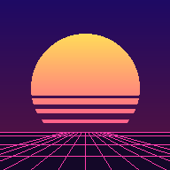
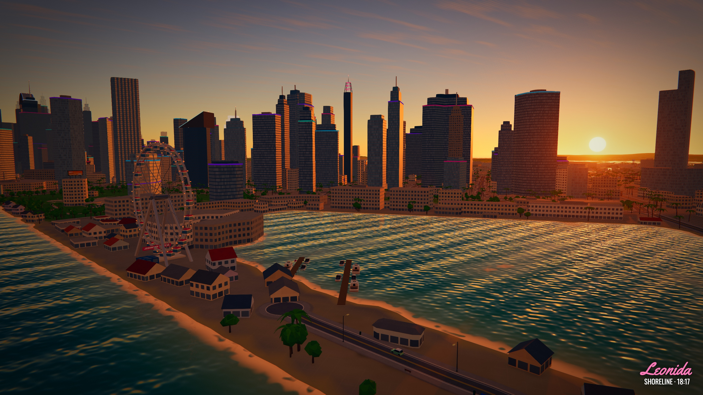
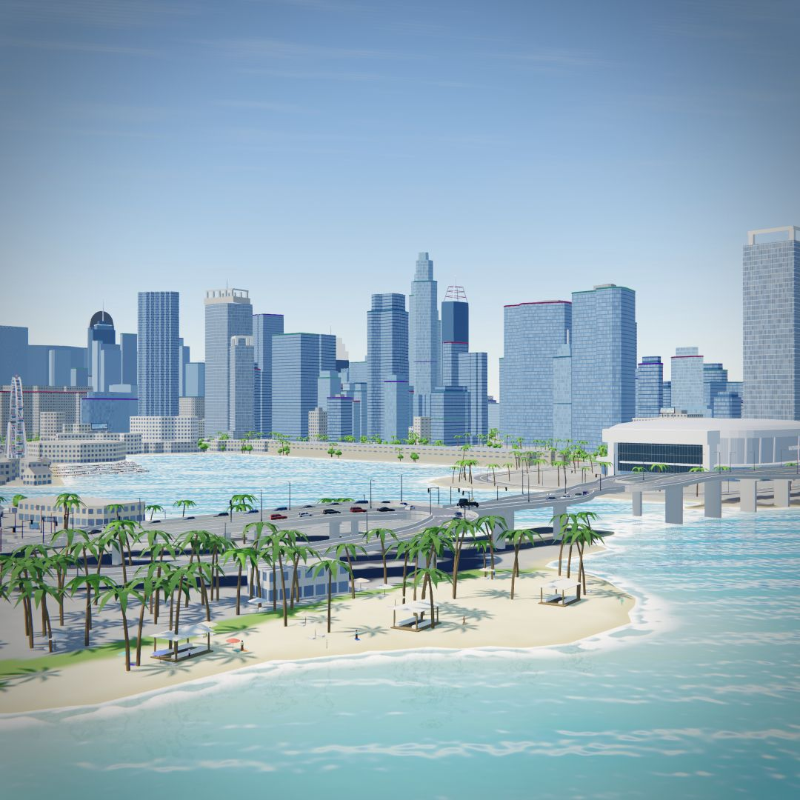

<p align="center"><a href="https://leonida-drive.io"></a></p>

# Leonida Drive

**Открытый мир в браузере: дороги, море, острова и другие игроки.**

### [▶ Открыть проект — leonida-drive.io](https://leonida-drive.io)

[English](README.md) · [Архитектура](docs/ARCHITECTURE.md) · [Правовая информация](LEGAL.md) · [Проверки](https://github.com/IPRIT/leonida-drive/actions/workflows/check.yml)

> [!IMPORTANT]
> **Бесплатный некоммерческий фанатский проект.** Не связан с Rockstar Games или Take-Two Interactive и не одобрен ими. Оригинальные игровые файлы, арт, музыка, логотипы и видео Rockstar Games не используются. Модели, текстуры, звуки и музыка созданы с нуля или генерируются кодом. **18+**: мультяшное насилие, аварии и взрывы. [Полный текст из About](LEGAL.md).



Ездите по побережью и горным дорогам, летайте, исследуйте острова на лодке, встречайте других игроков. На карте есть парки, аэродромы, достопримечательности, трафик и пешеходы. Заезды на время, доставки и открытки дают поводы свернуть с привычного маршрута.

- **139 видов транспорта:** автомобили, мотоциклы, велосипеды, самолёты, вертолёты, лодки и танк.
- **Одиночный и сетевой режимы.** В мультиплеере меню сохраняет движение мира.
- **Большая карта и миникарта:** GPS, категории мест, цветные стрелки игроков с никами и отдельный фильтр.
- **Настройка внешности:** гараж, окраска, тонировка, неон и гардероб.
- **Живой мир:** погода, смена дня и ночи, процедурный звук, разрушаемые объекты и 36 парков.
- **30 языков**, клавиатура, геймпад и сенсорное управление.

Для более чёткой картинки отключите **«Динамическое разрешение»** и выберите **масштаб от 50% до 200%**. Ручные 100% соответствуют разрешению экрана. Сглаживание настраивается отдельно: FXAA, SMAA и доступные на видеокарте режимы MSAA + SMAA. Перевёрнутая машина показывает подсказку с клавишей **R**.

Высоты дорог рассчитываются для всей сети, а 28 пересечений разведены по уровням. Проверки ищут разрывы покрытия, ступеньки и недостаточный просвет под мостами. Высоты и силуэты зданий остаются фанатской реконструкцией. «Состояние» в онлайне — баланс плюс цена продажи продаваемых машин; бесплатный стартовый транспорт и одежда его не увеличивают.

<details>
<summary>Watson Island и набережная Bayfront — дневной вид</summary>



</details>

## Локальный запуск

Нужны Node.js 22.13+ и npm. Готовые данные мира включены в репозиторий; Python нужен только для пересборки.

```bash
git clone https://github.com/IPRIT/leonida-drive.git
cd leonida-drive
npm ci
npm run dev
```

Откройте [127.0.0.1:5317](http://127.0.0.1:5317/) и выберите одиночный режим. Для мультиплеера запустите сервер во втором терминале:

```bash
cd server
npm ci
npm start
```

Двух игроков проверяйте через разные адреса — `localhost` и `127.0.0.1`: браузер хранит для них разные профили. На одном адресе новая вкладка перехватывает предыдущую сессию.

## Управление

| Клавиши | Действие |
| --- | --- |
| `W A S D` / стрелки | Движение |
| `Space` / `Shift` | Ручник / ускорение |
| `F` | Сесть в транспорт / выйти |
| `R` | Поставить транспорт на колёса |
| `G` / `E` | Гудок / взаимодействие |
| `C` | Камера |
| `H` / `L` | Свет / мигалки |
| `M` | Карта и GPS |
| `Tab` | Игроки |
| `Esc` | Меню, транспорт и настройки |
| `V` / `P` | Свободная камера / фоторежим |

Полное управление для каждого вида транспорта, геймпада и телефона — во вкладке «Управление».

## Разработка

Клиент построен на Vite, three.js и Rapier. Геометрия дорог, перекрёстков и зданий, модели удалённых машин и подготовка разрушений рассчитываются в фоновых потоках. Рендерер получает готовые массивы; физика работает в основном потоке. Удалённые объекты используют упрощённые модели, коллайдеры подгружаются рядом с игроком.

```bash
npm run check
npm --prefix server test
npm run build
```

Подробности: [структура и запуск](README.md), [сервер](server/README.md), [данные мира](docs/DATA_PIPELINE.md), [экономика](docs/ECONOMY.md). Время кадра зависит от устройства, браузера, разрешения и сцены.

Мир реконструирован по **YANIS v17** с [map.stateofleonida.net](https://map.stateofleonida.net/), данным ориентиров GTADB и отдельным прототипам зданий OpenStreetMap. Точность этой интерпретации фанатской карты проверяется отдельно от качества физики и отрисовки.

**Правообладателям, по вопросам удаления материалов и другим обращениям:** [help@leonida-drive.io](mailto:help@leonida-drive.io).

**Сам проект:** [leonida-drive.io](https://leonida-drive.io).
